# SNCF Sales Data Warehouse

Business intelligence project on French railway sales data: CSV sources loaded with Talend into MySQL, a star-schema data warehouse, and Power BI dashboards with DAX measures.

Academic project, ENSA Fès, Data Science and Artificial Intelligence engineering program (April 2026).

## Key figures

| Metric | Value |
|---|---|
| Reservations loaded | 10,000,000 (5 yearly files, 2021 to 2025) |
| Clients | 100,000 |
| Trains | 2,500 |
| Stations | 198 |
| Dimension tables | 9 (with role-playing departure and arrival stations) |
| Revenue analyzed | EUR 2.19 billion |
| Passengers | 30 million |
| Cancellation rate | 7.01% |

## Architecture

```
CSV files ──► Talend ──► sncf_oltp (MySQL) ──► Talend ──► sncf_dw (MySQL, star schema) ──► Power BI
```

1. **Source loading**: the CSV files (reservations, routes, clients, trains, stations) are loaded into the `sncf_oltp` database. The five yearly reservation files and the five yearly route files are merged with `tUnite` into a single table each.
2. **Dimensions**: Talend jobs read `sncf_oltp`, clean the data and fill the dimension tables of `sncf_dw`.
3. **Fact table**: `f_ventes` is built by joining reservations and routes, then resolving every foreign key with lookups on the dimensions.
4. **Reporting**: Power BI connects to `sncf_dw` and computes the indicators with DAX.

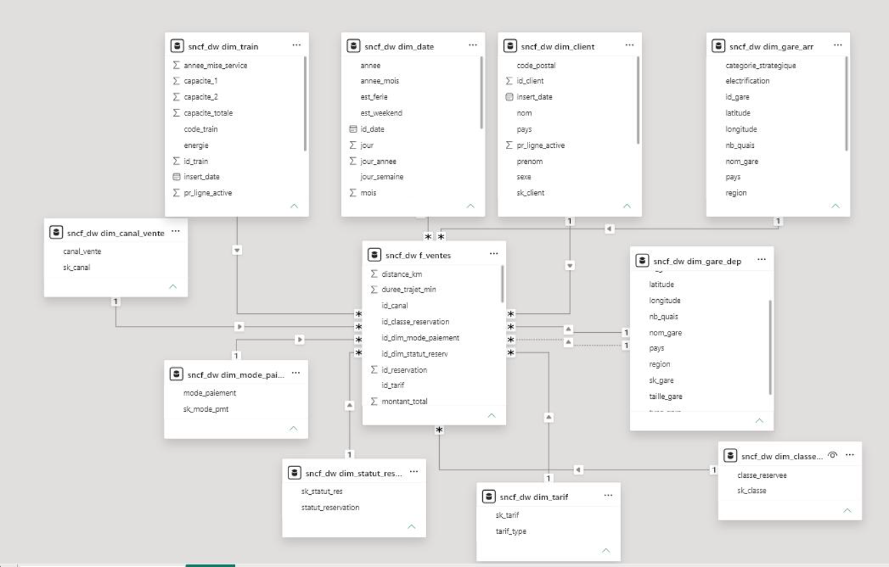

**Fact table**: `f_ventes` (amount, number of passengers, distance, travel time, price).
**Dimensions**: `dim_client` (Type 2 slowly changing dimension), `dim_train`, `dim_gare` (used twice: departure and arrival), `dim_date`, `dim_tarif`, `dim_canal_vente`, `dim_mode_paiement`, `dim_statut_reservation`, `dim_classe_reservation`.

## ETL with Talend

### Loading the sources

The reservation job reads the five yearly files, merges them with `tUnite` and writes 10 million rows into MySQL in a single table.

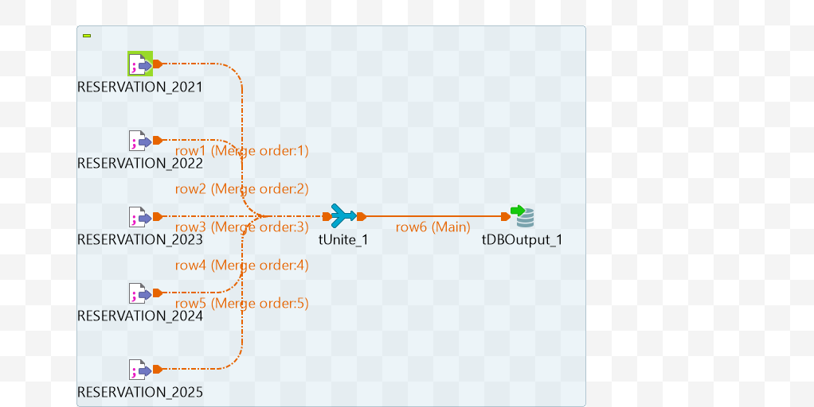

### Junk dimensions

One job reads the reservations once and builds five small dimensions (`dim_tarif`, `dim_canal_vente`, `dim_mode_paiement`, `dim_statut_reservation`, `dim_classe_reservation`). Each branch removes duplicates with `tUniqRow` and generates a surrogate key with `tMap`.

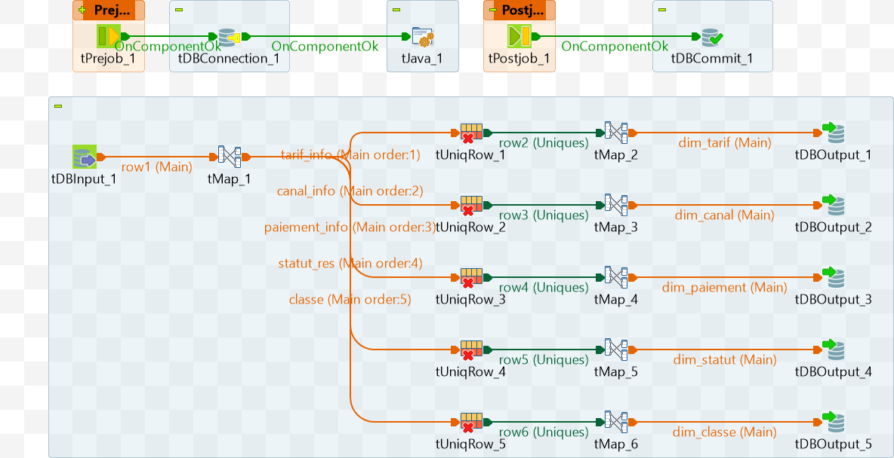

### Date dimension

`tRowGenerator` creates one row per day, `tMap` derives year, month, day of week, weekend and holiday flags. The job runs inside a transaction with commit and rollback.

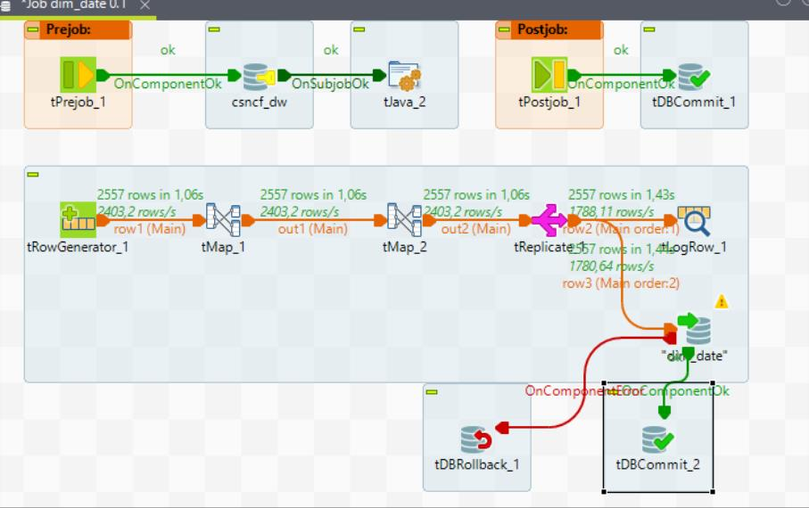

### Client dimension (Type 2 SCD)

New clients are inserted, unchanged clients are ignored, and modified clients get a new row while the old one is closed. History is kept with `insert_date`, `update_date` and `pr_ligne_active`.

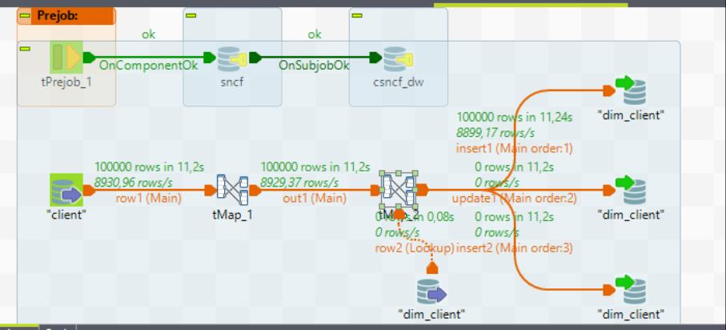

### Fact table

The reservations are processed year by year with `tLoop` to limit memory use. A single `tMap` joins them with the routes and looks up the surrogate keys of all dimensions, including the station dimension twice (departure and arrival).

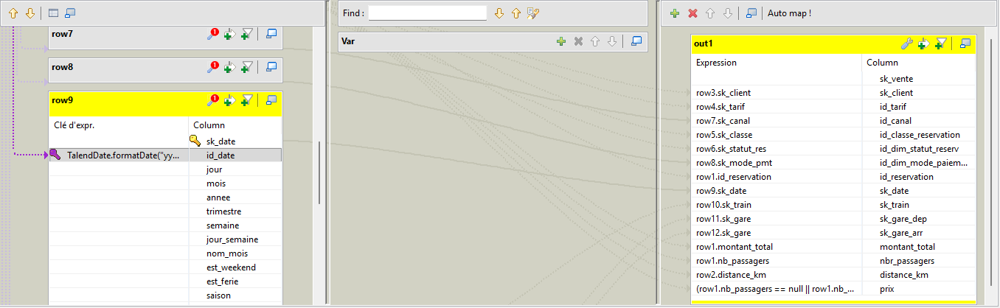

The `tMap` maps every lookup to its surrogate key in `f_ventes` (client, fare, channel, class, status, payment method, date, train, departure and arrival stations) and computes the measures.

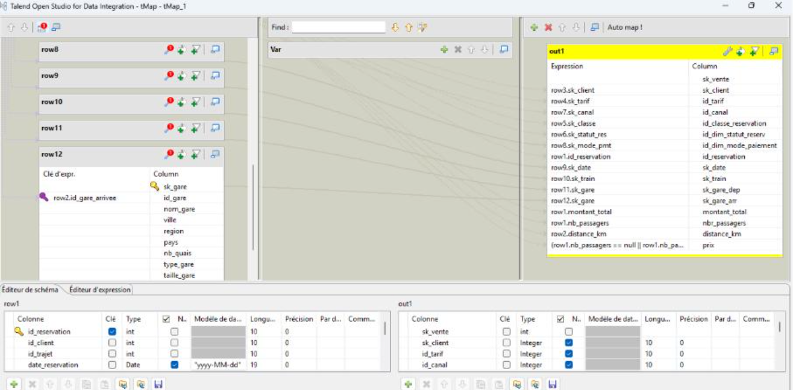

## Power BI dashboards

The dashboards are built on DAX measures such as `CA Total`, `Prix_Moyen_Tarif`, `Taux_Rempl_Type`, `CA_Mensuel` and `Croissance_YoY`.

**Revenue analysis**: revenue by year, month, train type, client type, fare, class, payment method and sales channel.

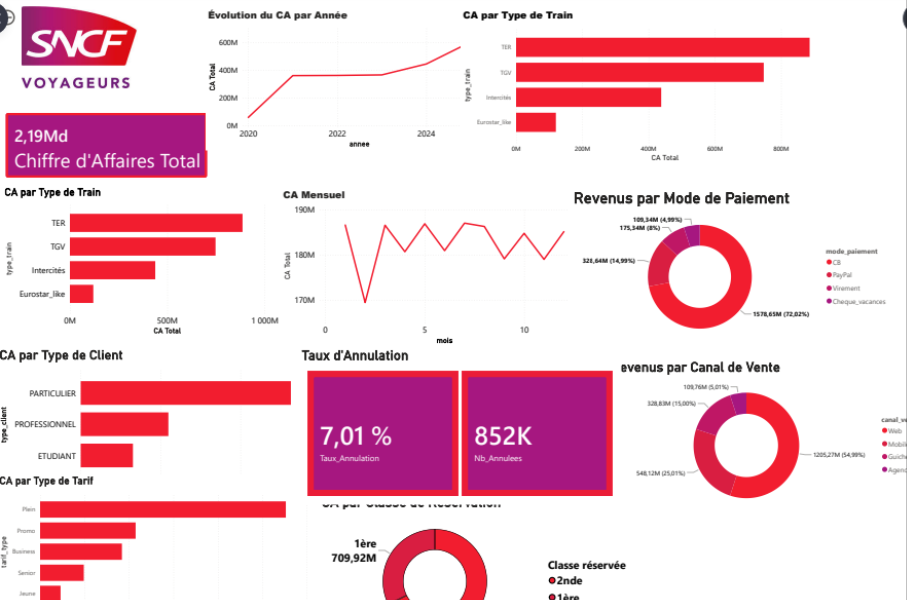

**Passenger demand**: 30 million passengers, passengers by train, by departure station and by region, under-performing trains and most profitable routes.

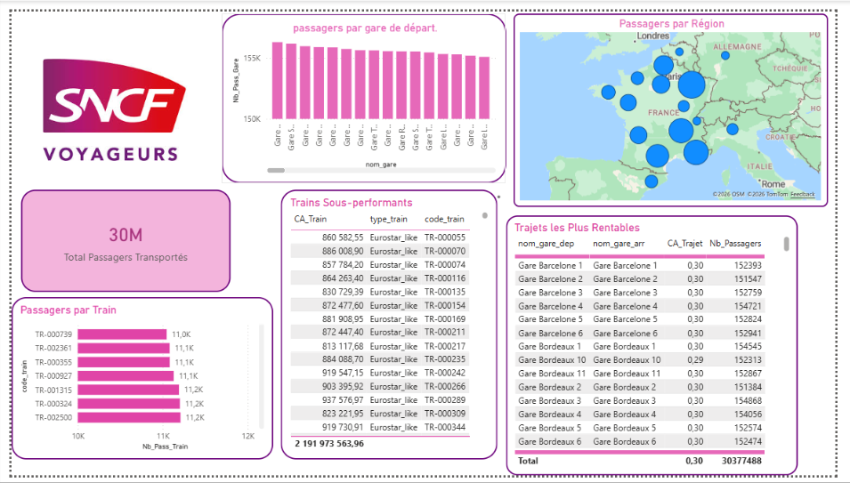

**Stations and regions**: revenue by station type, strategic category and region, with the top 10 stations.

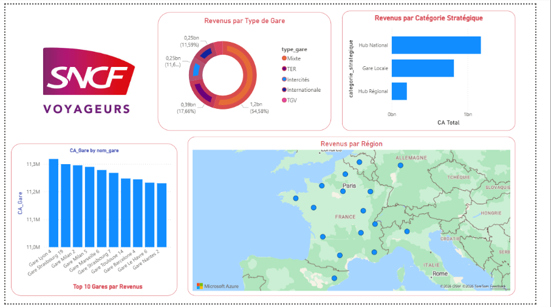

**Clients**: number of clients, clients by country, revenue by age bracket, account status and gender, top 20 clients.

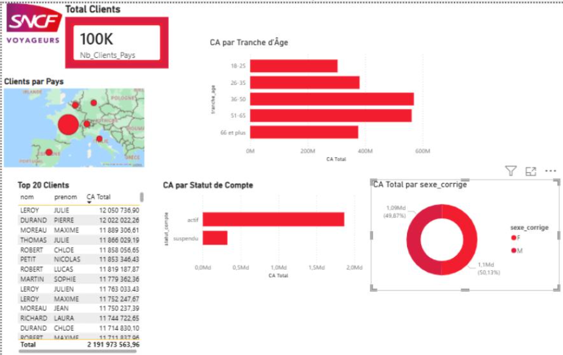

**Fares, sales channels and payments**: average price by fare type, reservations and revenue by sales channel, transactions and revenue by payment method, revenue by fare and class.

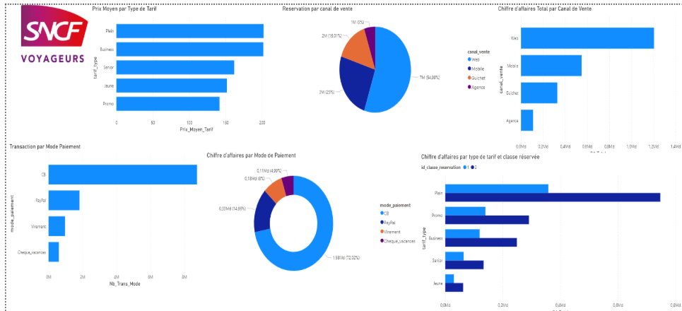

**Railway KPIs**: overall and per-train-type fill rate, monthly revenue by year, month-over-month and year-over-year growth, revenue by season and quarter.

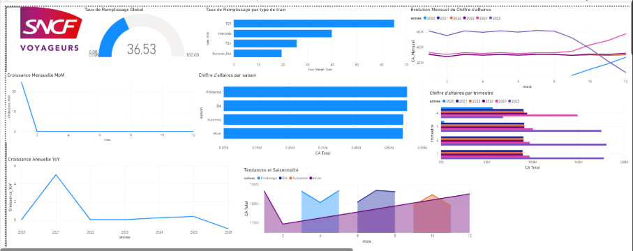

## Repository content

```
sql/
  01_create_databases.sql      creates sncf_oltp and sncf_dw with all tables
  02_load_csv_data.sql         loads the CSV files into sncf_oltp
talend/
  1_load_oltp/                 source loading jobs (clients, stations, trains, reservations, routes)
  2_create_dimensions/         date dimension and junk dimensions
  3_data_warehouse/            Talend project: dimension jobs and fact table job
powerbi/
  SNCF_Dashboard.pbit          Power BI template: data model, DAX measures, fares and railway KPI pages (no data)
screenshots/                   ETL jobs, star schema and dashboards
```

The CSV source files (more than 1 GB) and the `.pbix` file (more than 400 MB, it contains the data) are not included because of their size. The `.pbit` template opens in Power BI Desktop and asks for the MySQL connection to `sncf_dw`.

Database passwords have been removed from the Talend connection files: enter your own MySQL credentials after importing the jobs.

## Tech stack

Talend Open Studio for Data Integration 8, MySQL 8, Power BI Desktop, DAX, SQL.

## Author

Fatima Zahrae Chebiha, Data Science and AI engineering student, ENSA Fès.
[LinkedIn](https://www.linkedin.com/in/fatima-zahrae-chebiha) · [GitHub](https://github.com/FatimaZahraeChebiha)
